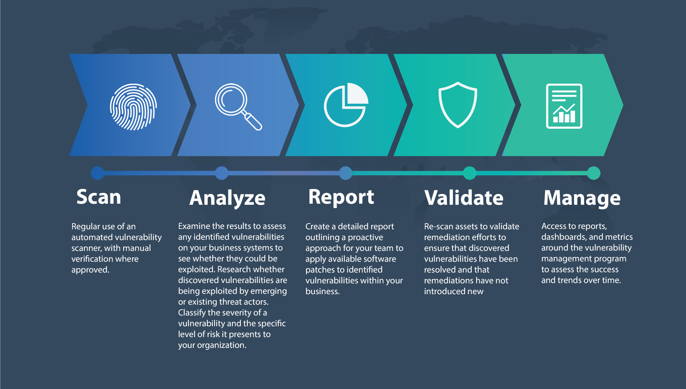
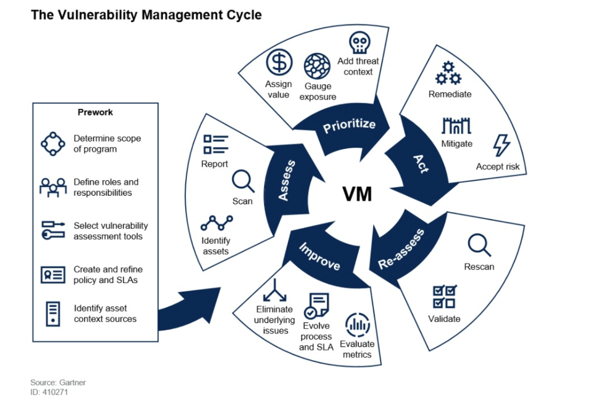

# Bytecodx - Software Vulnerabilities Management: Theory, Techniques, and Tools

An ongoing & curated collection of awesome software best practices and techniques, libraries and frameworks, e-books, research resources, technical guidelines, and industry-standard tools for Software Vulnerabilities Management in Cybersecurity, maintained by **Bytecodx**.
> Thanks to all contributors, you're awesome and wouldn't be possible without you! Our goal is to build a categorized community-driven collection of very well-known resources.

## `Table of Contents`
- [Vulnerability Management Process](#vulnerability-management-process)
- [Vulnerability Management Framework](#vulnerability-management-framework)
  - [Identifying Vulnerabilities](#1-identifying-vulnerabilities)
  - [Evaluating Vulnerabilities](#2-evaluating-vulnerabilities)
  - [Treating Vulnerabilities](#3-treating-vulnerabilities)
    - [Remediation](#remediation)
    - [Mitigation](#mitigation)
    - [Acceptance](#acceptance)
  - [Reporting Vulnerabilities](#4-reporting-vulnerabilities)
- [Vulnerability Management Lifecycle](#vulnerability-management-lifecycle)
- [Vulnerability Management Solutions](#vulnerability-management-solutions)
- [Curated Tools & Scanners](#curated-tools--scanners)
- [Knowledge Base & Research](#knowledge-base--research)

## `What is Vulnerability Management and Scanning?`

- Vulnerability management is the process of identifying, evaluating, treating, and reporting on security vulnerabilities in systems and the software that runs on them. This, implemented alongside with other security tactics, is vital for organizations to prioritize possible threats and minimizing their "attack surface."

- Security vulnerabilities, in turn, refer to technological weaknesses that allow attackers to compromise a product and the information it holds. This process needs to be performed continuously in order to keep up with new systems being added to networks, changes that are made to systems, and the discovery of new vulnerabilities over time.

## `Vulnerability Management Process`

The vulnerability management process is a continuous and cyclical practice of identifying, evaluating, treating, and reporting on security vulnerabilities. Establishing an effective process ensures that organizations maintain constant visibility into their attack surface, accurately assess exploitability and business risk, and promptly apply patches or compensating controls before threats materialize.

## `Vulnerability Management Framework`

- Helping you identify, classify, remediate, and mitigate vulns—before attackers do.

A vulnerability scanner automates the vulnerability process, typically breaking it down into the following four steps. It’s important to note that a good vulnerability management process should continually scan for vulnerabilities as they are introduced into the environment, as circumstances can quickly change.

### `1) Identifying vulnerabilities` 
> The first and most essential step in any vulnerability management process, of course, is to bring to light all of the vulnerabilities that may exist across your environment. A vulnerability scanner goes about this by scanning the full range of accessible systems that exist—from laptops, desktops, and servers on to databases, firewalls, switches, printers, and beyond.

From there, the vulnerability scanner identifies any open ports and services that are running on those systems, logging in to those systems and gathering detailed information where possible before correlating the information it obtains with known vulnerabilities. This insight can be used to create reports, metrics, and dashboards for a variety of audiences.

At the heart of a typical vulnerability management solution is a vulnerability scanner. The scan consists of four stages:

    - Scan network-accessible systems by pinging them or sending them TCP/UDP packets
    - Identify open ports and services running on scanned systems
    - If possible, remotely log in to systems to gather detailed system information
    - Correlate system information with known vulnerabilities

### `2) Evaluating vulnerabilities`

> Once you’ve identified all the vulnerabilities across your environment, you’ll need to evaluate them in order to appropriately deal with the risks they pose according to your organization’s risk management strategy. Different vulnerability management solutions use different risk ratings and scores for vulnerabilities, but one commonly referenced framework for new programs is the Common Vulnerability Scoring System (CVSS).

Vulnerability scores can help organizations determine how to prioritize the vulnerabilities they’ve discovered, it’s important to also consider other factors to form a complete understanding of the true risk posed by any given vulnerability. It’s also worth noting that vulnerability scanners can generate false positives in rare instances, thus underscoring the necessity of including other considerations in addition to risk scores at this stage of the process.

Here are some examples of additional factors to consider when evaluating vulnerabilities:

    - Is this vulnerability a true or false positive?
    - Could someone directly exploit this vulnerability from the Internet?
    - How difficult is it to exploit this vulnerability?
    - Is there known, published exploit code for this vulnerability?
    -  What would be the impact to the business if this vulnerability were exploited?
    - Are there any other security controls in place that reduce the likelihood and/or impact of this vulnerability being exploited?
    - How old is the vulnerability/how long has it been on the network?

### `3) Treating vulnerabilities`
After you’ve prioritized the vulnerabilities that you’ve found, it’s important to promptly treat them in collaboration with your original business or network stakeholders. Depending on the vulnerability in question, treatment usually proceeds according to one of the following three paths:

#### `Remediation`
> Fully fixing or patching a vulnerability so that it cannot be exploited, which is usually the most preferable option whenever possible.
    
#### `Mitigation`
> When remediation can’t be accomplished, an organization may choose the next best option of reducing the likelihood that a vulnerability will be exploited by implementing compensating controls. This solution should be temporary, buying time for an organization to eventually remediate the vulnerability.
 
#### `Acceptance`
> If a vulnerability is deemed low-risk or the cost of remediating it is much greater than it would be if it were exploited, an organization may choose simply to take no action to fix the vulnerability.

When determining specific treatment strategies, it is best for an organization’s security team, system owners, and system administrators to come together and determine the right remediation approach—whether that’s issuing a software patch or refreshing a fleet of physical servers. Once remediation is considered complete, it’s wise to run another vulnerability scan to make sure that the vulnerability has, in fact, been effectively remediated or mitigated.

### `4) Reporting vulnerabilities` 
> Improving the speed and accuracy with which you detect and treat vulnerabilities is essential to managing the risk that they represent, which is why many organizations continually assess the efficacy of their vulnerability management program. 

They can take advantage of the visual reporting capabilities found in vulnerability management solutions for this purpose. Armed with the insights needed, IT teams can identify which remediation techniques will help them fix the most vulnerabilities with the least amount of effort. Security teams, for their part, can use this reporting to monitor vulnerability trends over time and communicate their risk reduction progress to leadership. Ideal solutions will include integrations with IT ticketing systems and patching tools to accelerate the process of sharing information between teams. This helps customers make meaningful progress toward reducing their risk. Businesses can also use these assessments to fulfill their compliance and regulatory requirements

#### `Four tips for a better vulnerability management program`

 `1 - Conduct comprehensive scans.` 
 > While many businesses once found it sufficient to scan servers and desktop computers on the enterprise network, today’s complex and rapidly evolving IT environment requires a comprehensive approach. Your vulnerability management program should provide visibility into your entire attack surface, including the cloud, and automatically detect devices as they connect to your network for the first time.
 
` 2 - Continually assess your vulnerabilities.` 
 > Infrastructures and applications can change on a daily and even hourly basis. For this reason, you must continually scan your environment to make sure that you identify new vulnerabilities as early as possible. Many vulnerability management solutions include endpoint agents and other integrations that can provide you with a real-time view of vulnerabilities across your environment.
 
 `3 - Accelerate your processes.` 
> Introducing automation into the vulnerability management process is essential to properly managing the modern risks your business faces at scale.  Human decisions play a critical role in every vulnerability management program, but automation can help streamline the repetitive work that is done before and following these key decision points.
 
 `4 - Address weaknesses in people, too. `
 > Vulnerabilities are not limited to technology; they exist in the human element within an organization as well. Security teams must collaborate with IT operations and application development groups to more quickly identify and remediate vulnerabilities of all kinds. Meanwhile, user education and simulations can increase your organization’s resilience to phishing and other social-engineering attacks.

## `Vulnerability Management Lifecycle`

> Detailed guide: [vulnerability-management-lifecycle.md](vulnerability-management-lifecycle.md)

There are several stages in the vulnerability management process that vulnerability management programs should adhere to. While there are different ways to define each stage in the cycle, the process is still generally the same, even if the terminology varies.

### `1 - Pre-work for a Vulnerability Management Program`

    Step 1. Determine Scope of the Program
    Step 2. Define Roles and Responsibilities
    Step 3. Select Vulnerability Assessment tools
    Step 4. Create and Refine Policy and SLAs
    Step 5. Identify Asset Context Sources
    
    
    
This pre-work stage assesses and measures current resources, processes and tools in order to identify gaps.During the pre-work phase, a security professional should ask questions that can help determine the scope of your program, including:

    - Which assets will we measure for vulnerabilities?
    - Which assets or hosts are most critical in protecting?
    - Who will be managing this program? What roles and responsibilities do they have?
    - When a vulnerability is detected, how long will we have to remediate? What policies or service level agreements (SLAs) do we need to define? How often should we assess our assets for vulnerabilities or weak points?
    - What tools or software do we need to effectively manage or scan our hosts?
    - What list of assets within our asset types do we plan to cover? Or more simply, what is the context of the assets that we wish to manage?

### `2 - What are the 5 Steps of the Vulnerability Management Cycle`

    Step 1. Assess
    Step 2. Prioritize
    Step 3. Act
    Step 4. Reassess
    Step 5. Improve

## `Vulnerability Management Solutions` 
- Managing exposure to known vulnerabilities is the primary responsibility of a vulnerability manager. Although vulnerability management involves more than simply running a scanning tool, a high-quality vulnerability tool or toolset can dramatically improve the implementation and ongoing success of a vulnerability management program.
The market is filled with options and solutions, each claiming leading qualities. When evaluating a vulnerability management solution, keep these things in mind:

#### `Timeliness is important`
> If a vulnerability management tool fails to detect vulnerabilities in a timely manner, then the tool isn’t very useful and doesn’t contribute to overall protection. This is where network-based scanners often fail. It can take a long time to complete a scan and consume a large portion of your organization’s valuable bandwidth only to produce immediately outdated information. It’s better to choose a solution that relies on a lightweight agent rather than on a network.

#### `Performance impact on an endpoint is key`
> Increasingly, vulnerability scanning vendors claim to offer agent-based solutions. Unfortunately, most of these agents are so bulky that they dramatically impact an endpoint’s performance. Therefore, when searching for an agent-based tool, look for one with a lightweight agent — one that consumes very little space on an endpoint to minimize any effect on productivity.

#### `Real-time, comprehensive visibility is critical` 
> You should be able to see what’s vulnerable in an instant. Legacy vulnerability tools can hinder visibility — network scans take a long time and provide outdated results, bloated agents slow business productivity, and bulky reports do little to help address vulnerabilities in a timely manner. 

## `Curated Tools & Scanners`

An overview of industry-standard vulnerability management and assessment tools:

### Network & Infrastructure Scanners
| Tool | Type | Key Capabilities |
| :--- | :--- | :--- |
| **[OpenVAS / Greenbone](https://www.greenbone.net/en/community-edition/)** | Open-Source | Comprehensive network vulnerability scanner with daily feed updates. |
| **[Tenable Nessus](https://www.tenable.com/products/nessus)** | Commercial | Widely used vulnerability assessment scanner for systems, OS, and software. |
| **[Qualys VMDR](https://www.qualys.com/apps/vulnerability-management-detection-response/)** | Cloud / SaaS | Cloud-based asset discovery, vulnerability detection, and response. |
| **[Rapid7 InsightVM](https://www.rapid7.com/products/insightvm/)** | Commercial | Real-time endpoint scanning, analytics, and risk prioritization. |

### Application & Container Security (SAST / DAST / Containers)
| Tool | Category | Key Capabilities |
| :--- | :--- | :--- |
| **[Trivy](https://github.com/aquasecurity/trivy)** | Container / IaC | Vulnerability scanner for container images, Git repositories, and Kubernetes. |
| **[Semgrep](https://semgrep.dev/)** | SAST | Fast, lightweight static code analysis to find bugs and enforce security standards. |
| **[OWASP ZAP](https://www.zaproxy.org/)** | DAST | Dynamic web application security scanner for identifying live vulnerabilities. |
| **[Snyk](https://snyk.io/)** | SCA / DevSecOps | Developer-first security scanning for open-source dependencies and code. |

### Threat Intelligence & Risk Scoring
- **[CISA Known Exploited Vulnerabilities (KEV) Catalog](https://www.cisa.gov/known-exploited-vulnerabilities-catalog)**: The authoritative catalog of vulnerabilities actively exploited in the wild.
- **[FIRST EPSS (Exploit Prediction Scoring System)](https://www.first.org/epss/)**: Data-driven estimate of the probability that a software vulnerability will be exploited.
- **[NVD (National Vulnerability Database)](https://nvd.nist.gov/)**: Repository of standards-based vulnerability management data using CVSS.

## `Knowledge Base & Research`

Explore the extended security modules included in this project:

- 📋 **[Vulnerability Management Lifecycle Guide](vulnerability-management-lifecycle.md)**: In-depth breakdown of the 5 operational phases and SLA planning.
- 🔬 **[Bytecodx Vulnerability Research Module](Vulnerability-Research/README.md)**: Curated guides, tutorials, papers, and tools for vulnerability researchers.
- 📖 **[Comprehensive Cybersecurity Glossary](Vulnerability-Research/GLOSSARY.md)**: Dictionary of core vulnerability, reverse-engineering, and exploit terminology.

**[`^        back to top        ^`](#)**

## License
MIT License & [cc](https://creativecommons.org/licenses/by/4.0/) license

 This work is licensed under a <a rel="license" href="http://creativecommons.org/licenses/by/4.0/">Creative Commons Attribution 4.0 International License</a>.

To the extent possible under law, [Bytecodx / Poovarasan (SDP-001)](https://github.com/SDP-001) has waived all copyright and related or neighboring rights to this work.
