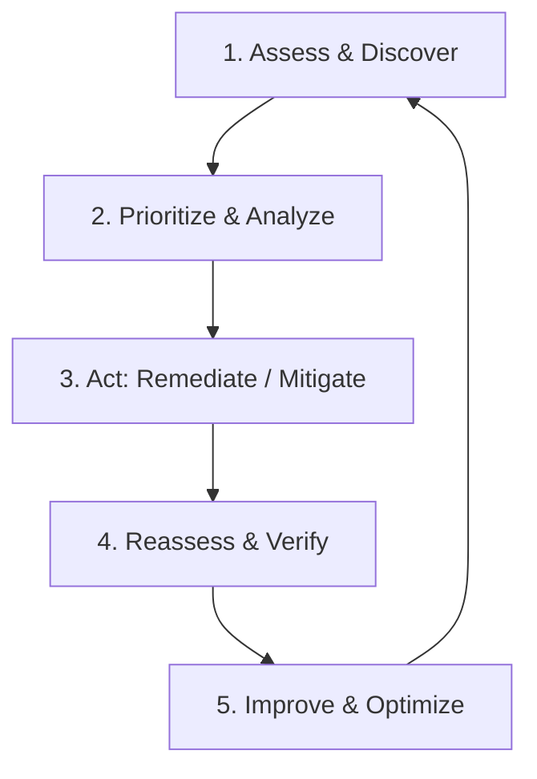

# Bytecodx - Vulnerability Management Lifecycle

The Vulnerability Management Lifecycle is a structured, cyclical process designed to continually detect, prioritize, and mitigate security weaknesses within an organization's IT infrastructure.

> Reference: [CrowdStrike Cybersecurity 101 - Vulnerability Management Lifecycle](https://www.crowdstrike.com/cybersecurity-101/vulnerability-management/vulnerability-management-lifecycle/)

---

## 1. Pre-work: Program Foundation & Scope

Before initiating active vulnerability assessments, establish standard operating procedures and governance:

1. **Determine Program Scope**: Identify all hardware, software, cloud infrastructure, and network perimeters in scope.
2. **Define Roles & Responsibilities**: Establish RACI (Responsible, Accountable, Consulted, Informed) matrices across security, operations, and application teams.
3. **Select Vulnerability Assessment Tools**: Choose agent-based, network-based, and application security testing solutions matching your technology stack.
4. **Create & Refine Policies / SLAs**: Define remediation timelines based on CVSS / risk scores (e.g., Critical within 48-72 hours, High within 14 days).
5. **Identify Asset Context Sources**: Integrate with Configuration Management Databases (CMDB), cloud asset inventories, and business criticality catalogs.

---

## 2. The 5 Core Phases of the Vulnerability Cycle

### Phase 1: Assess & Discover
- Scan all IT assets, containers, virtual machines, cloud workloads, and endpoints.
- Discover newly joined unmanaged assets across networks.
- Enumerate running software, versions, open ports, and configuration states.

### Phase 2: Prioritize
- Evaluate raw vulnerability scan results against real-world risk metrics:
  - **CVSS Score** (Base, Temporal, Environmental metrics).
  - **Threat Intelligence & Exploitation Status** (Known Exploited Vulnerabilities - CISA KEV).
  - **Asset Criticality**: Is the affected asset public-facing, hosting customer PII, or holding confidential IP?
  - **Compensating Controls**: Are WAFs, firewalls, or network segmentation already neutralizing the threat path?

### Phase 3: Act (Remediation, Mitigation, Acceptance)
- **Remediation**: Deploy vendor software patches, upgrade libraries, or reconfigure misconfigurations to permanently eliminate the risk.
- **Mitigation**: Deploy interim compensating controls (virtual patching, ACL adjustments, port closure) if a patch is unavailable or unfeasible immediately.
- **Acceptance**: Formally document and accept residual risk with executive sign-off if exploitation likelihood is negligible and remediation costs are prohibitive.

### Phase 4: Reassess
- Run differential scans to verify successful remediation.
- Validate that patches or configuration changes did not introduce functional regressions or new vulnerabilities.
- Close resolved tickets within IT Service Management (ITSM) systems.

### Phase 5: Improve
- Conduct root cause analyses for recurrent vulnerability categories.
- Enhance automated patch management and secure baseline configurations (e.g., CIS benchmarks).
- Report metrics (MTTD, MTTR, SLA adherence) to security leadership and executive stakeholders.
